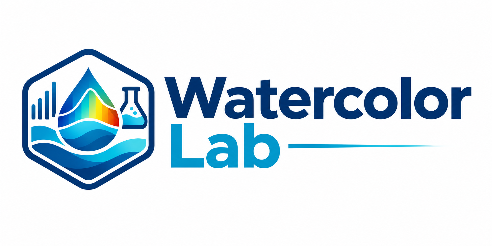

<p align="center">
  
</p>

<p align="center">
  Processing tools for ocean-color laboratory measurements.
</p>

<p align="center">
  <a href="https://b-rech.github.io/watercolorlab/">Documentation</a>
  ·
  <a href="https://github.com/b-rech/watercolorlab/tree/main/examples">Examples</a>
  ·
  <a href="https://github.com/b-rech/watercolorlab/issues">Issues</a>
</p>

# WatercolorLab

WatercolorLab is a Python library for processing laboratory measurements used
in ocean-color research. It provides shared spectral data handling and
processors for colored dissolved organic matter (CDOM) and particulate
absorption.

## Features

- Read and organize measurements from supported instruments with
  `watercolorlab.read_files`.
- Manage spectral data and metadata through `watercolorlab.Spectra`.
- Calculate blank-corrected CDOM absorption coefficients.
- Fit exponential CDOM absorption models and retrieve reference absorption
  and spectral slope.
- Retrieve total, depigmented, and phytoplankton-associated particulate
  absorption from transmittance and reflectance measurements.
- Apply validation and quality-control checks during processing.
- Document the implemented algorithms with mathematical ATBDs.

## Installation

WatercolorLab supports Python 3.11 or newer on Windows, macOS, and Linux.
Using a virtual environment is recommended.

### Install from GitHub

```bash
python -m pip install git+https://github.com/b-rech/watercolorlab.git
```

### Install from a local clone

```bash
git clone https://github.com/b-rech/watercolorlab.git
cd watercolorlab
python -m pip install .
```

### Install with Conda

From a local clone:

```bash
conda env create -f environment.yml
conda activate watercolorlab
```

The Conda environment contains the library runtime dependencies only.
JupyterLab, Spyder, and documentation tools are optional.

## Quick start

The public API exposes `read_files` and `Spectra` directly:

```python
import watercolorlab as wcl

data = wcl.read_files(
    path="data/cdom",
    instrument="wpi",
    format_string="{pattern}_{id}_{replicate}_{campaign}",
    sample_pattern="ponto",
    blank_pattern="milliq",
)

spectra = wcl.Spectra(data)
spectra.cdom.compute_absorption(
    wl_null_point_correction=(590, 600),
    pathlength=0.1,
)
spectra.cdom.expfit(wl_ref=443, wl_range=(350, 500))
```

The calculated curves are available in `spectra.absorption`, and the fitted
CDOM parameters are available in `spectra.cdom_fitted`.

Particulate processing follows the same `read_files` and `Spectra` workflow,
with transmittance and reflectance measurements classified through the input
metadata. See the [particulate processing guide](docs/user-guide/particulate.md)
for the complete setup.

## Documentation

The documentation site includes:

- [Getting started](https://b-rech.github.io/watercolorlab/getting-started/)
- [CDOM processing guide](https://b-rech.github.io/watercolorlab/user-guide/cdom/)
- [Particulate processing guide](https://b-rech.github.io/watercolorlab/user-guide/particulate/)
- [CDOM ATBD](https://b-rech.github.io/watercolorlab/cdom_atbd/)
- [Particulate ATBD](https://b-rech.github.io/watercolorlab/particulate_atbd/)
- [API reference](https://b-rech.github.io/watercolorlab/api-reference/)

The ATBDs describe the equations and current implementation behavior. They
are intended to support comparison with external standard protocols.

## Examples

- [CDOM processing with WPI data](examples/cdom_processing_wpi.ipynb)
- [Particulate processing with PerkinElmer data](examples/tr_processing_perkinelmer.ipynb)

To run the notebooks:

```bash
conda activate watercolorlab
conda install -c conda-forge jupyterlab
jupyter lab
```

## Development

Documentation dependencies are listed in
[docs/requirements.txt](docs/requirements.txt). Build the documentation
locally with:

```bash
python -m pip install -r docs/requirements.txt
mkdocs serve
```

## Scientific reference

The CDOM workflow follows the [IOCCG CDOM absorption
protocol](https://ioccg.org/wp-content/uploads/2019/10/cdom_abs_protocol_public_draft-19oct-2019-sm.pdf).
The implementation-specific behavior and quality-control rules are documented
in the CDOM ATBD.

## License and credits

Developed and maintained by
[Bruno Rech](https://github.com/b-rech). See [LICENSE](LICENSE) for license
information.
