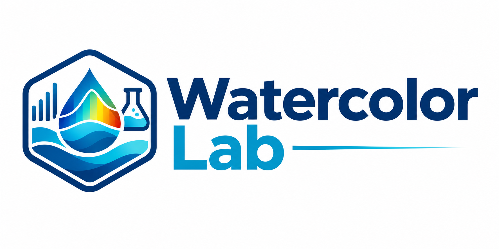

  

# WatercolorLab

WatercolorLab processes ocean-color laboratory measurements, including
colored dissolved organic matter (CDOM) and particulate absorption.

## Documentation

- [Getting started](getting-started.md)
- [CDOM processing](user-guide/cdom.md)
- [Particulate processing](user-guide/particulate.md)
- [CDOM algorithm basis](cdom_atbd.md)
- [Particulate algorithm basis](particulate_atbd.md)
- [Consistency algorithm basis](consistency_atbd.md)
- [API reference](api-reference.md)

The algorithm documents describe the equations and current implementation.
They are intended to support comparison with external standard protocols.

## Project

Source code and examples are available in the
[GitHub repository](https://github.com/b-rech/watercolorlab).
